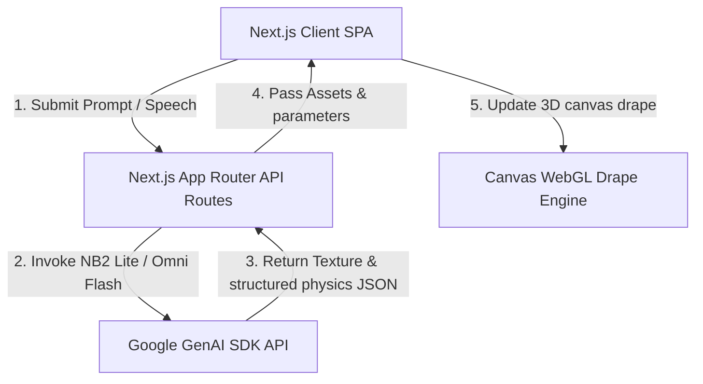
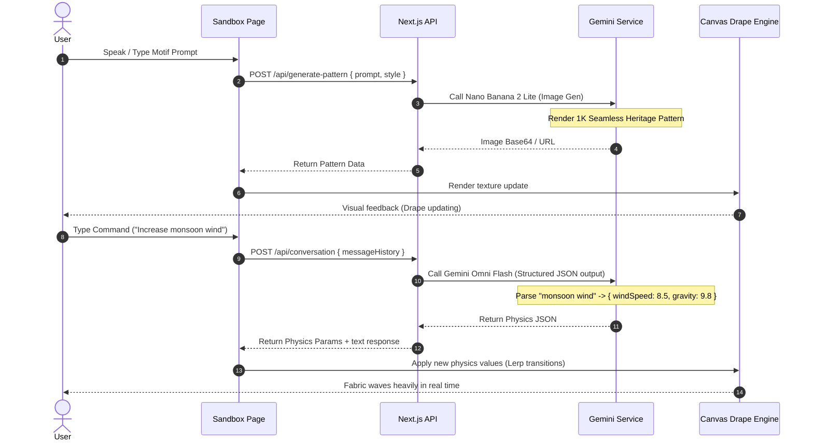

# System Architecture

This document describes the architectural design, component layout, data flow, and technology choices for the **Indic-Typography Heritage Animator**.

## 1. System Topology

The application is structured as a monolithic Next.js App Router project written in TypeScript. We split concerns between a Client-Side interactive canvas/voice visualizer and Server-Side API endpoints that encapsulate the GenAI calls.

---

## 2. Component Design & Responsibilities

- **`page.tsx` (Main Page):** Handles root application state, including current texture image URL, wind strength, drape mode, conversational message list, and error handling.
- **`CanvasVisualizer.tsx`:** An HTML5 Canvas component utilizing mathematical vertex displacement. It renders:
  - Mannequin contour silhouette.
  - Generative fabric grid mapped to a 3D-deformed surface.
  - Verlet-integration drape animation based on wind velocity, wave frequency, gravity, and fabric drag.
- **`VoiceInput.tsx`:** Integrates the browser's native `webkitSpeechRecognition` to provide hands-free voice control.
- **`ChatPanel.tsx`:** Standard chat window allowing the user to type conversational adjustments.
- **`geminiService.ts`:** Centralized service containing:
  - `generatePattern(prompt: string): Promise<string>` - Image generation with Nano Banana 2 Lite.
  - `refinePhysics(messages: Message[]): Promise<PhysicsParams>` - Physics translation with Gemini Omni Flash.
- **`mockService.ts`:** Renders high-fidelity, high-speed procedural textures (Banarasi, Kalamkari, Ikat) on-the-fly when the API is disabled or offline, ensuring sub-second execution speeds.

---

## 3. Sequenced Operations Flow

The sequence below illustrates the fabric pattern creation and subsequent conversational physics refinement:

---

## 4. Technology Decisions Rationale

1. **Next.js App Router (TypeScript):** Provides unified client and server-side codebases. Type safety prevents runtime property failures.
2. **HTML5 Canvas (2D Context with Math Vertex projection):** Rather than loading heavy 3D rendering engines (like Three.js), which take seconds to compile and load, we use a high-performance 2D Canvas with a calculated 3D deformation grid. This ensures sub-millisecond drawing routines and instant layout loads, achieving the hackathon goal of **sub-second visual feedback**.
3. **Structured Outputs (JSON Schema):** We force Gemini Omni Flash to return a specific JSON schema. This completely eliminates regex parsing errors and guarantees that the physics engine receives exact numerical constants.
